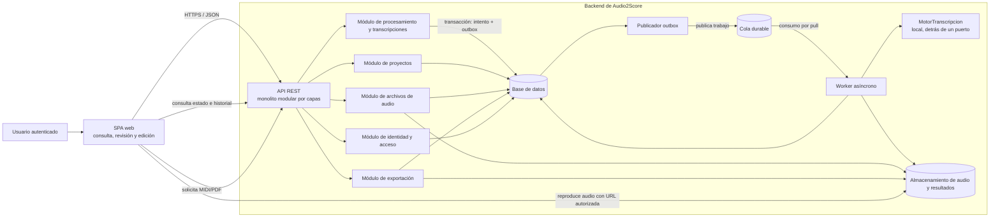

# Arquitectura de equipo — Audio2Score

**Estado:** Propuesta consolidada para revisión del equipo  
**Base:** `decision_arquitectonica_ADRIAN.md`, `decision_arquitectonica_IVAN.md`, `openapi_equipo.yaml` y `diagrama_clases_equipo.puml`.

## Decisión arquitectónica

Audio2Score se implementará como una aplicación cliente-servidor con una SPA y una API REST organizada como **monolito modular en capas**. El procesamiento de audio será asíncrono: la API registra el intento de procesamiento y su mensaje de outbox en una transacción; un publicador entrega el trabajo a una cola durable; un worker lo consume y ejecuta el motor de transcripción local. El worker guarda el intento y la transcripción versionada en la base de datos.

El motor local se integra detrás de un puerto `MotorTranscripcion`; no se considera un servicio externo. El almacenamiento conserva audio, transcripciones y exportaciones. La API valida la propiedad del proyecto en las operaciones protegidas y genera MIDI/PDF bajo demanda a partir de la transcripción vigente. La SPA consulta el estado y permite revisar y editar la partitura; cada edición crea una nueva versión.

La decisión mantiene una sola base de código y una unidad de despliegue para la aplicación, con un proceso worker separado para ejecutar trabajos largos. Para el esquema de la Parte 1, el equipo eligió PostgreSQL 13 o posterior. El OpenAPI define autenticación JWT Bearer; el cierre de sesión revoca el `jti` hasta su expiración. Las tecnologías de SPA, broker y almacenamiento de objetos siguen por elegir.

## Diagrama de componentes

## Responsabilidades y límites

| Componente | Responsabilidad |
|---|---|
| SPA web | Presentar proyectos, cargar audio, consultar estados e historial, reproducir audio y revisar/editar la transcripción. |
| API REST | Exponer las operaciones definidas en `openapi_equipo.yaml`, validar solicitudes, autenticar y aplicar autorización por propietario. |
| Módulos de dominio | Separar identidad/acceso, proyectos, audio, procesamiento/transcripciones y exportaciones dentro del monolito. |
| Base de datos | Persistir usuarios, proyectos, archivos asociados, intentos, versiones de transcripción, notas y exportaciones. |
| Outbox y publicador | Registrar el evento de procesamiento junto con el intento y publicar trabajos sin perderlos entre la transacción y la cola. |
| Cola durable | Mantener los trabajos pendientes para consumo asíncrono y recuperación. El producto concreto queda por decidir. |
| Worker | Reclamar trabajos, actualizar estados/heartbeat, aplicar idempotencia y reintentos, invocar el motor y persistir resultados. |
| MotorTranscripcion local | Procesar el audio dentro del límite de confianza del sistema y devolver datos estructurados para una transcripción. |
| Almacenamiento de objetos | Conservar audios y archivos MIDI/PDF; permitir acceso autorizado y eliminación conforme a la política de retención. |
| Exportación | Generar MIDI/PDF bajo demanda a partir de la transcripción vigente y registrar el resultado descargable. |

## Análisis de diferencias y acuerdos

| Tema | ADR de Adrián | ADR de Iván | Acuerdo consolidado |
|---|---|---|---|
| Estilo principal | Monolito modular en capas | Cliente-servidor con SPA y API REST, monolito modular por capas | Se adopta el detalle de Iván como vista de interacción; se conserva el monolito modular en capas. |
| Procesamiento | Cola y worker asíncrono | Cola durable, outbox, worker por pull, idempotencia, lease/heartbeat y recuperación | Se adopta el flujo robusto de Iván. Los estados de intento siguen el contrato compartido: pendiente, procesando, completado y fallido. |
| Motor musical | No especifica ubicación | Motor local detrás de `MotorTranscripcion`; no enviar audio a terceros sin autorización | Motor local detrás de un puerto; proveedor externo no forma parte de esta arquitectura. |
| Persistencia de transcripciones | Persiste la transcripción resultante | Conserva transcripciones estructuradas y versiones; edición crea nueva versión | Se acuerdan versiones inmutables, con `Project.currentTranscriptionId` señalando la versión vigente, conforme al diagrama de clases y OpenAPI consolidados. |
| Exportaciones | Descarga MIDI/PDF | API genera MIDI/PDF bajo demanda desde versión vigente | Se adopta generación bajo demanda y control de propiedad antes de descarga. |
| Seguridad | Control de acceso por propietario centralizado | API autentica y autoriza propietario por recurso; JWT Bearer definido en OpenAPI | Se aplica autorización por propietario en la API. El contrato usa JWT Bearer y el esquema registra tokens revocados para cumplir el cierre de sesión. |
| Respaldo y borrado | No desarrolla el ciclo de respaldo | Borrado debe cubrir datos primarios, derivados y respaldos; parámetros pendientes | Se registra como requisito operativo pendiente: definir proveedor, retención y plazo de purga, sin inventar valores. |
| Escala y despliegue | Una unidad, worker desacoplable | Una aplicación y proceso worker; no microservicios de negocio | Se conserva una sola aplicación modular; worker separado como proceso ejecutable, sin adoptar microservicios. |
| Restricción del equipo | Asume un desarrollador | También describe un desarrollador | No se toma esa cantidad como dato del equipo actual; se usa únicamente la conclusión de mantener baja complejidad operativa. |

## Flujo de procesamiento

1. El usuario carga un MP3 o WAV asociado a un proyecto. La API valida formato, límites y propiedad.
2. Si faltan parámetros requeridos, la API informa cuáles son y el trabajo espera la configuración; si no faltan, el procesamiento puede iniciar automáticamente, de acuerdo con el contrato OpenAPI consolidado.
3. En una transacción, la API registra el intento y el mensaje outbox. El publicador entrega el trabajo a la cola durable.
4. El worker consume el trabajo usando el identificador del intento para evitar duplicados, actualiza su estado y ejecuta `MotorTranscripcion` localmente.
5. El worker persiste el resultado como una transcripción nueva y actualiza el estado del intento y del proyecto. Si falla, registra el motivo y permite el flujo de reintento definido por la API.
6. La SPA consulta el estado/historial y presenta la transcripción. Al guardar una corrección, se crea una nueva versión en lugar de sobrescribir la anterior.

## Coherencia con los artefactos compartidos

- `openapi_equipo.yaml` define los límites HTTP: autenticación, proyectos, carga de audio, configuración/reintento, estado/historial, transcripciones y exportaciones.
- `diagrama_clases_equipo.puml` define las entidades persistentes y DTO principales: `Project`, `AudioFile`, `ProcessingAttempt`, `Transcription`, `MusicalNote` y `Export`, entre otras.
- La arquitectura asigna esos datos a los componentes: proyectos/audio/transcripciones/intentos/exportaciones se persisten; las solicitudes pasan por la API; el worker crea intentos y transcripciones; exportación genera archivos a partir de una transcripción vigente.
- La autorización por propietario debe comprobarse en cada operación que consulta, modifica, reproduce o descarga recursos del proyecto.

## Decisiones aún pendientes

- Definir firma, claims, renovación y ciclo de vida operativo de JWT, manteniendo el cierre de sesión mediante revocación del `jti`.
- Elegir base de datos, broker/cola, almacenamiento de objetos y formato de despliegue.
- Definir configuración exacta del motor local, límites de reintentos y tiempos de lease/heartbeat.
- Definir política de respaldos, retención y plazo de purga para audios, derivados y copias.
- Medir el rendimiento del motor en el entorno de prueba acordado para confirmar el objetivo de procesamiento de RNF-01.

Estas decisiones de implementación no cambian el estilo arquitectónico acordado; deben documentarse antes de cerrar la arquitectura ejecutable.
